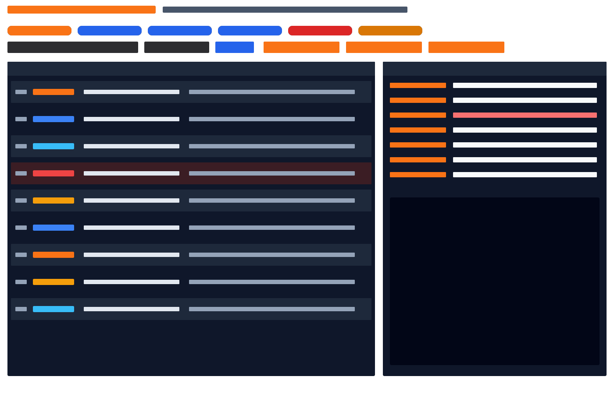

# ArgoCD & Flux GitOps Viewer for VS Code

Inspect ArgoCD (`Application`, `ApplicationSet`, `AppProject`) and Flux v2 (`GitRepository`, `HelmRepository`, `OCIRepository`, `Kustomization`, `HelmRelease`) GitOps manifests in VS Code without running `argocd`, `flux`, `kubectl`, or making any network requests. GitOps YAML files often hide floating `HEAD` or `main` target revisions, `suspend: true` freezes left after an incident, wildcard `sourceRepos` in an `AppProject`, plain HTTP repository URLs, or `prune: true` without `selfHeal`. This extension parses multi-document GitOps manifests statically in plain JavaScript with zero cloud calls.

## What it opens

- ArgoCD manifests: `application.yaml`, `applicationset.yaml`, `appproject.yaml`, `*.argocd.yaml` and multi-document YAML files containing `argoproj.io` resources.
- Flux v2 manifests: `gotk-sync.yaml`, `gotk-components.yaml`, `gitrepository.yaml`, `helmrelease.yaml` and `*.flux.yaml` containing `toolkit.fluxcd.io` resources.
- Any matching file via the Command Palette or Explorer context menu (Open in ArgoCD & Flux GitOps Viewer).
- Nothing to install, no cluster binary invoked, no cloud or network calls.

## The free part

- GitOps summary bar: shows engine (`ArgoCD`, `Flux v2`, or `ArgoCD + Flux`), line count, resource count, source repo count, sync policy count, destination count, and static findings.
- Apps and resources view: lists every CRD in multi-document YAML with engine, kind, source reference, destination namespace and risk status.
- Sources and repos view: summarizes Git, Helm and OCI repository URLs, revisions, branches, paths and chart names.
- Sync and reconcile view: inspects automated `prune` and `selfHeal`, reconciliation `interval`, `retryInterval`, `suspend` flags and `syncOptions`.
- Destinations and scope view: shows target cluster servers, namespaces, `AppProject` scope and `dependsOn` ordering, plus static security findings.

## The Pro tools, with 1 free try

Pro adds the audit, diff and export steps: generate a Markdown sync and security audit for one GitOps manifest or a folder, compare two ArgoCD or Flux YAML files in Markdown, or export Markdown and CSV application and source inventories locally. Your first try of each Pro tool is free. Zovo Pro is USD 19 once, and the team licence is USD 59.

## Why not plain text

Reading a 500-line multi-document `gotk-sync.yaml` or `application.yaml` in plain text makes it easy to miss a `suspend: true` flag, a floating `targetRevision: HEAD`, or a wildcard `clusterResourceWhitelist`. A local visual inspector puts applications, sources, sync policies, destinations and findings on one screen.

## More tools by Zovo

See full docs and install options at [vscode.zovo.one/extensions/zovo-argocd-flux-gitops-viewer/](https://vscode.zovo.one/extensions/zovo-argocd-flux-gitops-viewer/), browse all Zovo VS Code extensions at [vscode.zovo.one](https://vscode.zovo.one/), or explore [Zovo Pro](https://vscode.zovo.one/pro/).
